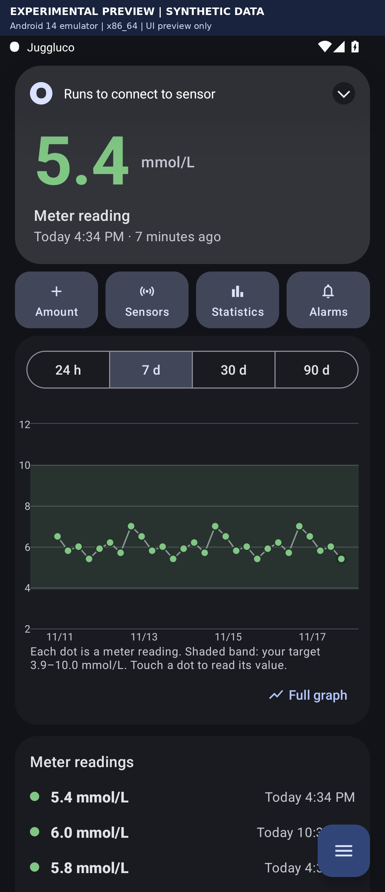
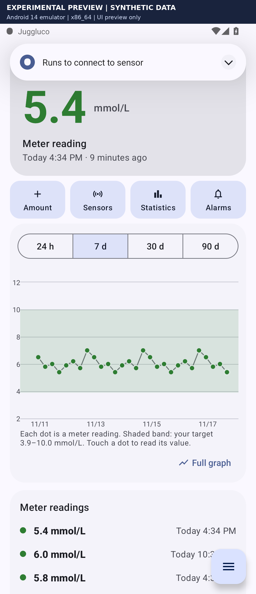
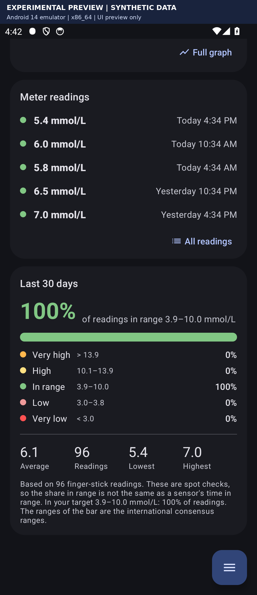
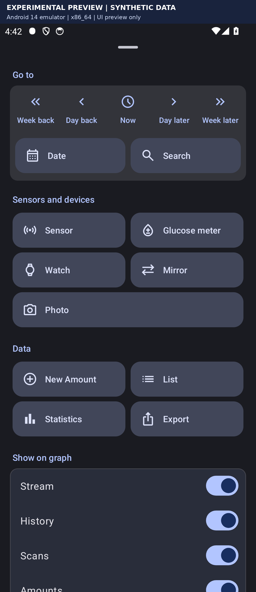
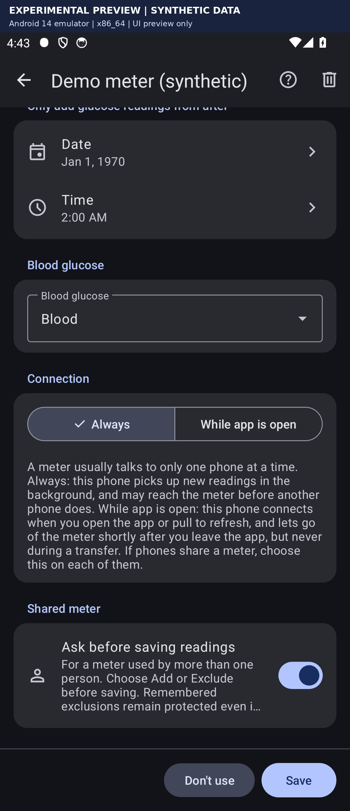
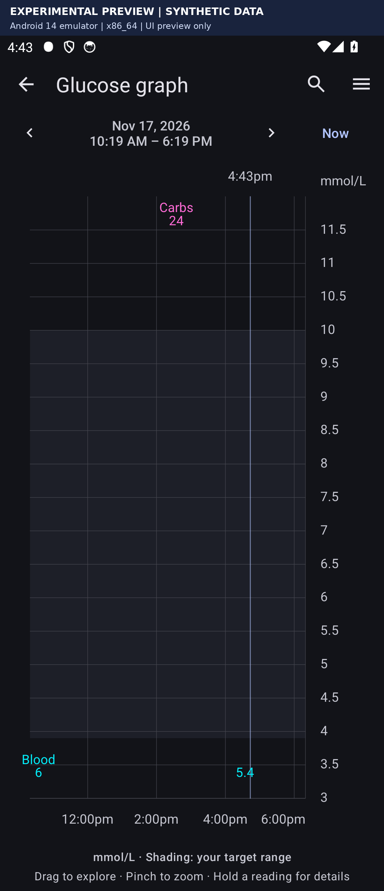
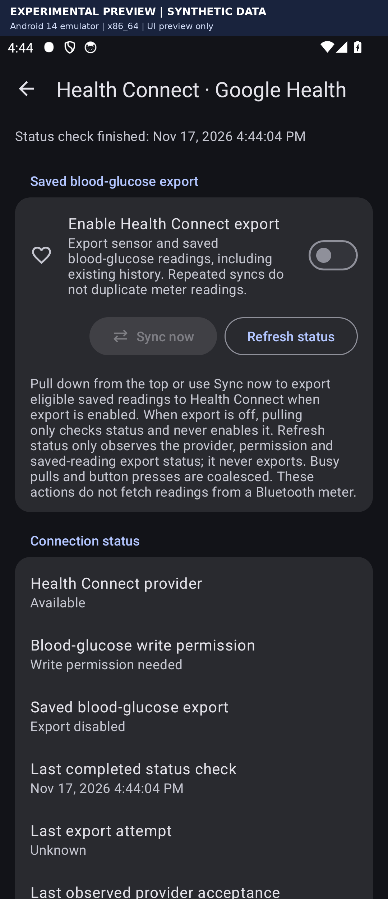
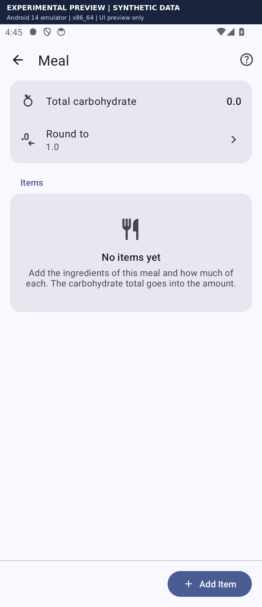

# Juggluco Material 3 phone preview

> **Experimental fork preview, not an official Juggluco release.** All screenshots use synthetic data on a dedicated Android emulator. This work has not had a complete security audit or comprehensive physical sensor/meter validation. It is not clinically validated.

## Review and download

- [Beta source branch](https://github.com/lazmo88/Juggluco/tree/beta/material3)
- [Preview release and signed ARM64 APK](https://github.com/lazmo88/Juggluco/releases/tag/material3-preview-20261117)
- [Original project](https://github.com/j-kaltes/Juggluco), by Jaap Korthals Altes
- [Source-to-artifact record](ARTIFACTS.md) and [pending-source hashes](apk-source-manifest.json)

This preview updates the phone UI while retaining the native detailed graph and landscape workflow. It was developed with substantial AI assistance and is offered for discussion, not as a request to merge one large replacement. No upstream PR has been opened for this preview.

## Changes to discuss

- Material 3 navigation, themes, settings, alarms, sensors, data entry, meals and sharing screens.
- A portrait dashboard with meter/sensor-specific summaries and charts; meter spot-check share-in-range is distinguished from sensor time-in-range.
- A new Android frame around the existing native detailed graph.
- Shared-meter Add/Exclude/Later review, durable conversion bindings and legacy-resolution safeguards.
- Health Connect export/status/sync for accepted, saved meter readings, with exporter ownership and duplicate-prevention rules.
- Per-meter Always / While-app-open connection policy and explicit refresh outcomes.
- Browser-based ChatGPT sign-in work, intended as a separate review unit.

The work is based on upstream **11.5.7**. Upstream **12.0.5** has not yet been integrated. UI, native storage/export and Bluetooth changes should be reviewed separately; approximately 12 review units are proposed, subject to maintainer preference and dependency extraction.

## Synthetic screenshot gallery

These are captures of a non-shipping **x86_64 build of the same application source**, running on Android 14/API 34. Only an ABI-selection entry was added to the emulator build configuration. A separate, non-shipping instrumentation APK seeded 96 invented blood-glucose rows and one inactive fictional meter in the emulator. No account was configured, no physical sensor/meter was connected, and Health Connect export stayed disabled. The downloadable ARM64 phone APK does not contain this instrumentation or preloaded synthetic data.

The disclosure banner above each image was added after capture; the application pixels underneath are unchanged. The screenshots demonstrate UI appearance, not live sensor accuracy, provider export success or multi-phone interoperability.

| Dark dashboard | Light dashboard |
|---|---|
|  |  |

| Meter-only 30-day summary | Material navigation |
|---|---|
|  |  |

| Shared-meter controls | Native detailed graph |
|---|---|
|  |  |

| Health Connect status, export disabled | Meals, empty state |
|---|---|
|  |  |

## Visible preview caveats

Independent image review confirmed the light/dark labels and that the large summary `100%` is fully visible. These captures are not a defect-free release showcase:

- On the dashboard, the floating menu button overlaps parts of some lower reading timestamps.
- On the scrolled meter settings page, part of a section heading sits under the fixed app bar and the shared-meter explanation is ellipsized.
- The menu screenshot is a partial view of a scrolling sheet; additional controls continue below the viewport.
- The native Full graph capture contains a rendered grid, target shading and synthetic amount/blood annotations, **not a continuous sensor trace**. No real or simulated streaming sensor is claimed.
- The meal capture is an intentional empty state; the Health Connect capture explicitly shows export disabled and missing write permission.

## Evidence and limitations

- The ARM64 APK was built successfully from the maintained source; signature verification and source-file hash checks passed. It uses the same certificate as the prior test APK.
- The owner installed this APK over the existing test app and reports the previously clipped percentage now renders correctly. This is visual field feedback, not broad device or clinical acceptance.
- A dedicated Android row fixture passed 72 clipping/layout checks. It is not a full-APK test suite.
- Targeted regressions rerun from the staged source passed: 17 decision tests, 4 binding/persistence tests, 5 connection-policy tests, 3 menu-resource tests, and native import/reset/plot/search suites (including ASan/UBSan where configured). Harness boundaries remain in the individual test documentation; a host fixture does not prove Android or physical-device behavior.
- The preview x86_64 APK was launched, seeded and navigated on a dedicated emulator; its crash buffer was empty after the capture session. Historical acceptance on other builds is not presented as an exact-APK pass here.
- Complete security review, comprehensive real sensor/meter/alarm testing, controlled two-phone handoff, downstream Google Health display, current Wear OS acceptance, and integration with upstream 12.0.5 remain pending.
- The existing beta retains some untranslated/new English strings and other inherited limitations. Do not assume a complete language or accessibility audit.

## Installation boundaries

The release asset is the **ARM64 phone test package `tk.glucodata.dub`**, not the Play package `tk.glucodata`. Existing matching test installs can update without uninstalling; take an appropriate private backup first. **Do not run this and another app against the same sensor or meter simultaneously.** Do not assume downgrading will reverse new persisted state. Sensor-specific binary prerequisites and build notes in the upstream README still apply; sensor compatibility of this APK has not been established.

The release is a preview for code/UI review, not a hardened or production-approved distribution. A release-build configuration, matching signature and successful tests do not establish medical safety. No personal health data, user-provided screenshots, account credentials or private application backups are included in the preview package.

## Build

Use the upstream toolchain/prerequisites in the repository README. The phone artifact was built with:

```sh
./gradlew --no-daemon --console=plain --max-workers=4 -Pabi=arm64-v8a :Common:assembleMobileLibre3SiDexGoogleReleasedub
```

Do not commit local SDK/JDK paths, signing credentials or downloaded proprietary binary prerequisites. Build scripts must keep signing values in-place and out of logs. See `ARTIFACTS.md` for the immutable APK hash and the source snapshot relationship; reproducible byte-for-byte rebuilds have not been established.
